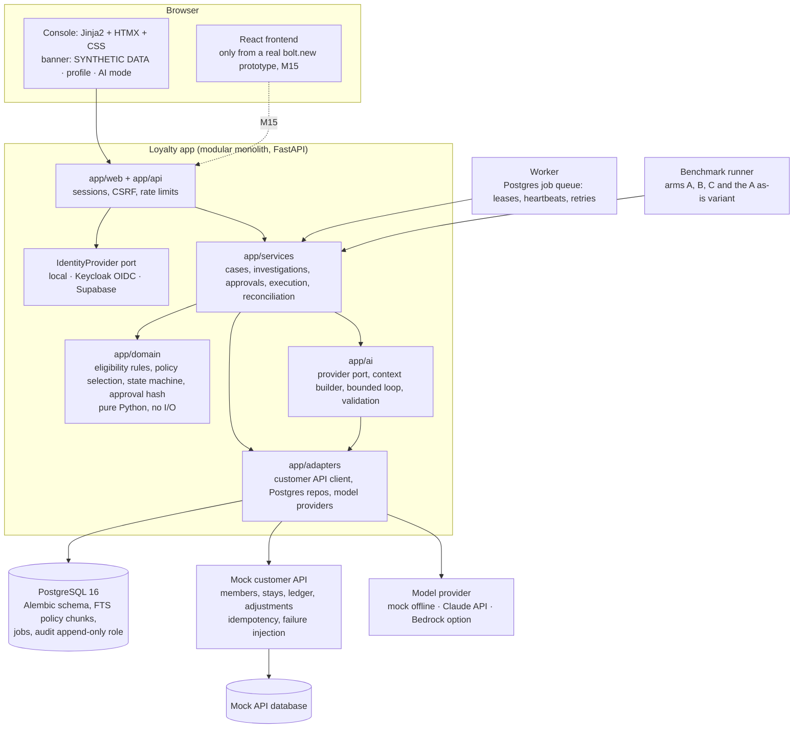

# Architecture

> Simulated client engagement, synthetic data. Requirement DISC-12. This is the design for Milestones 3–14; nothing
> below is built yet unless the requirements matrix says so. Decisions: `docs/decisions.md`.

## 1. System diagram

## 2. Components

| Component | Responsibility | Never does | Milestone |
|---|---|---|---|
| `app/domain` | Eligibility, points, policy-version selection, case state machine, approval-binding hash | Import web, DB session, HTTP or model SDK code (a test enforces this) | 6 |
| `app/services` | Use cases: create case, investigate, request info, propose, approve, execute, reconcile | Trust a role or approval from request data | 6–8 |
| `app/ai` | Provider interface, context builder (minimised, redacted, budgeted), bounded state-machine loop, output validation, one bounded repair | Decide eligibility, amounts, approval or execution; store chain-of-thought | 8 |
| `app/adapters` | Customer API client (timeouts, typed errors, retries for transient errors only), repositories, providers | Fall back silently to another provider or data destination | 4, 8 |
| `app/web`, `app/api` | Console pages, JSON API, OpenAPI docs | Expose ground truth or stack traces | 5–7 |
| Worker | Durable jobs: investigations, executions, reconciliation, retention | Keep critical work in memory | 6 |
| Mock customer API | Synthetic loyalty platform and PMS with versioned OpenAPI contracts, atomic idempotency, seeded failures | Pretend to be a real system | 4 |
| Benchmark runner | Runs arms on splits, stores results with versions, compares runs | Show expected answers to any arm | 10 |

## 3. Data flow and trust boundaries (summary; full threat model in `security/threat-model.md`)
1. Browser → app: session cookie, CSRF token; role resolved server-side.
2. App → mock customer API: service token; calls carry correlation IDs; responses validated against the contract.
3. App → model provider (arm C, live mode only): minimised, redacted context; no secrets; no member data beyond the
   fields the task needs; destination fixed by configuration.
4. App ↔ Postgres: application role for business tables; append-only role for audit events.
5. Worker ↔ Postgres: same database, job leases with `FOR UPDATE SKIP LOCKED`.

## 4. Key technical tradeoffs

| Choice | Alternative | Why this one | Cost of the choice |
|---|---|---|---|
| Modular monolith + separate mock API | Microservices | One deployable, simpler transactions; the mock API is separate because a real customer API would be | Must keep module boundaries by discipline and tests |
| Postgres job queue | Redis/RQ, a broker | One database, transactional enqueue with the business write | Throughput limits at large scale (Stage 10 territory) |
| Postgres full-text search | Embeddings, a vector DB | Baseline first; policies are short and versioned | Weak on meaning-only phrasing until measured otherwise (ADR-0008) |
| Plain state machine loop | Agent framework | Every stop condition explicit and tested | More code we own |
| Server-rendered console | SPA first | Always works, no build step, easier CSP | Less interactive until the React frontend |
| Approval hash recomputed at execution | Approval as a status flag | Any change cancels the approval | Approvals expire more often; supervisors re-approve |
| Idempotency key derived from the approval ID | Random key per attempt | Retries and concurrent executes reuse one key | Requires the upstream API to honour keys (exactly-once needs downstream cooperation) |

## 5. Prototype vs pilot vs production

| Concern | Prototype (this project) | Pilot (real engagement) | Production |
|---|---|---|---|
| Data | Synthetic only | Authorized, minimised real data | Same, with retention and DSR processes |
| Systems | Mock customer API | Real sandbox / test endpoints | Real endpoints with change control |
| Identity | Local demo auth; local Keycloak | Client IdP (OIDC), group-to-role mapping | Same plus MFA for privileged roles, SCIM |
| Hosting | Docker Compose locally; optional low-cost demo | Client-approved cloud account | Hardened deployment, private networking, backups tested |
| AI | Mock provider; live Claude with a budget cap | Approved provider and region | Same plus monitoring, drift signals, canaries |
| Evidence | Offline benchmark | Shadow mode and supervised pilot | Ongoing QA sampling and regression gates |
| Approvals | Simulated supervisor in the benchmark | Real supervisors | Real supervisors; audit review |

Nothing in this repository is claimed production-ready. Local tests prove local behaviour only.

## 6. Operating profiles
Portfolio (default), live-model, discovery, staging, approved, enterprise-identity. `python -m app.preflight`
checks each without printing values (ADR-0014). One identity adapter active per deployment (ADR-0003).
