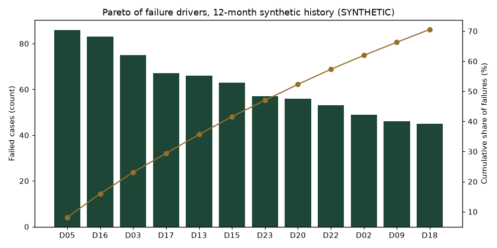
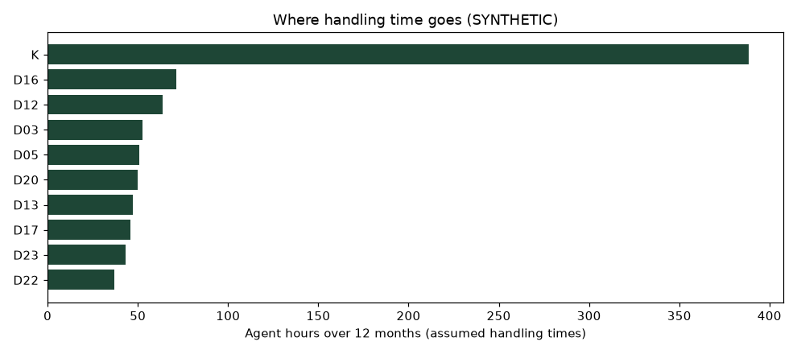
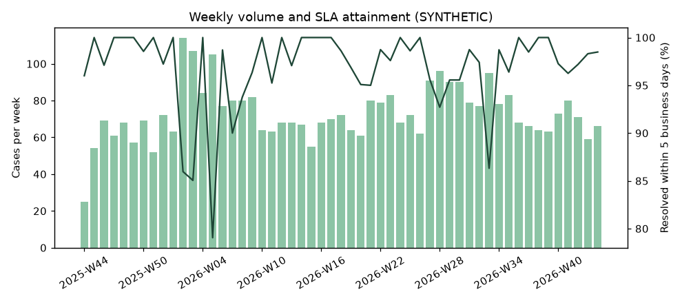
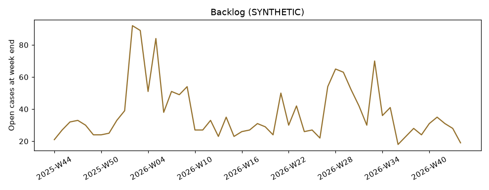

# Day-one discovery: what the legacy loyalty queue looks like

> **SYNTHETIC history generated from documented assumptions; the numbers demonstrate the analysis method and restate those assumptions. They are not findings about a real operation.** Generated by `python -m evaluations.discovery_analysis` from `seed_data/v1/history/` (dataset v1, seed 20261102). Money figures are estimates under assumptions A3 and A4 (`docs/customer-discovery.md` §6).

## What I'd say in the first meeting

Over 12 months (2025-W44 to 2026-W44) the queue handled **3,872 missing-points requests**. **1,057 (27%)** ended with the wrong points: 824 under-credited, 215 over-credited and 18 credited twice. Three drivers (D05, D16, D03) account for 23% of the failures. 1,338 cases needed more than one contact and 287 were reopened. Only 96% were resolved within 5 business days.

Under the stated assumptions, over-credits cost about **$13,078** in points liability, members were left **6,521,570 points** short (about $52,173), and handling cost about **$38,752** ($10.01 per case). These are estimates, not measurements.

The pre-registered catalog predicts that **about 61% of these failures are fixable without AI** (arm B), about 21% need AI (arm C), and about 9% come from defects split between the two (nicknames, attached documents). The benchmark will test that prediction.

## Pareto of failure drivers

| Driver | Defect | Cases | Failed | Failure rate | Cumulative share | Primary fix | Predicted fixing arm |
|---|---|---|---|---|---|---|---|
| D05 | OTA confirmation format not searchable | 126 | 86 | 68% | 8% | Integration fix | B |
| D16 | Several stays in one message | 113 | 83 | 73% | 16% | AI-assisted | C |
| D03 | Missing booking channel | 117 | 75 | 64% | 23% | Configuration fix | B |
| D17 | Wrong or partial confirmation numbers | 109 | 67 | 61% | 29% | UI fix | B |
| D13 | Member lookup needs an exact match | 117 | 66 | 56% | 36% | UI fix | B |
| D15 | No policy version by stay date | 81 | 63 | 78% | 42% | UI fix | B |
| D23 | Non-English requests | 94 | 57 | 61% | 47% | AI-assisted | C |
| D20 | Points claim mixed with a complaint | 106 | 56 | 53% | 52% | AI-assisted | C |
| D22 | Evidence only in an attached folio or receipt | 93 | 53 | 57% | 57% | AI-assisted | B partly, C rest |
| D02 | Stays on a merged member number | 69 | 49 | 71% | 62% | Integration fix | B |
| D09 | New OTA rule missing from legacy rules and index | 58 | 46 | 79% | 66% | Configuration fix | B |
| D18 | Nicknames and name formats | 87 | 45 | 52% | 71% | AI-assisted | B partly, C rest |
| D06 | Late postings, visible only in the posting feed | 77 | 41 | 53% | 74% | Integration fix | B |
| D07 | Reversed and re-posted transactions | 72 | 37 | 51% | 78% | UI fix | B |
| D21 | Corporate exception buried in policy text | 39 | 35 | 90% | 81% | Configuration fix | B |
| K | Control cases | 1882 | 32 | 2% | 84% | control | A (already correct) |
| D19 | Dates in mixed formats | 76 | 30 | 39% | 87% | AI-assisted | C |
| D04 | UTC timestamps read as local dates | 81 | 30 | 37% | 90% | Data fix | B |
| D25 | Conflicting records | 46 | 23 | 50% | 92% | None possible | none (escalate) |
| D08 | Old 30-day wait still set at Mountain Lodge | 86 | 21 | 24% | 94% | Configuration fix | B |
| D12 | Search misses synonyms | 170 | 21 | 12% | 96% | UI fix | B |
| D10 | No duplicate check across cases | 37 | 18 | 49% | 98% | Training/process | platform (all arms) |
| D01 | Duplicate member profiles | 89 | 13 | 15% | 99% | Data fix | B |
| D24 | Stay record genuinely missing upstream | 38 | 5 | 13% | 100% | None possible | none (escalate) |
| D11 | No approval binding | 9 | 5 | 56% | 100% | Training/process | platform (all arms) |

## Modelled cost of failures (estimates under stated assumptions)

| Driver | Over-credited points | Under-credited points | Rework + leakage cost (USD) |
|---|---|---|---|
| D15 | 454,770 | 0 | 3,744 |
| D06 | 311,490 | 0 | 2,585 |
| D07 | 305,800 | 0 | 2,536 |
| D25 | 187,380 | 0 | 1,573 |
| D10 | 136,810 | 0 | 1,152 |
| D01 | 105,470 | 0 | 978 |
| K | 42,718 | 147,090 | 889 |
| D03 | 0 | 652,570 | 474 |
| D05 | 0 | 711,470 | 432 |
| D16 | 0 | 625,930 | 422 |

Sensitivity (each assumption moved -50% / +50%):

| Assumption | Factor | Value | Over-credit leakage (USD) | Handling cost (USD) |
|---|---|---|---|---|
| point_value_usd | 0.5 | 0.004 | 6,539 | 38,752 |
| point_value_usd | 1.0 | 0.008 | 13,078 | 38,752 |
| point_value_usd | 1.5 | 0.012 | 19,617 | 38,752 |
| agent_cost_per_hour_usd | 0.5 | 16 | 13,078 | 19,376 |
| agent_cost_per_hour_usd | 1.0 | 32 | 13,078 | 38,752 |
| agent_cost_per_hour_usd | 1.5 | 48 | 13,078 | 58,129 |

## Where handling time goes

Median handling time 16.4 minutes (assumed distribution, not measured). Every case also pays the four-screen lookup (D14), visible as at least four `searched` events per case.

## Rework loops (from the event log)

| Event | Count |
|---|---|
| adjusted | 1,989 |
| approved | 1,989 |
| created | 3,872 |
| escalated | 30 |
| info_requested | 1,052 |
| member_replied | 1,840 |
| proposed | 1,989 |
| reopened | 287 |
| resolved | 3,872 |
| searched | 19,522 |

Modelled satisfaction proxy by outcome (formula in the generator config; not real sentiment): correct 4.8, duplicate_credit 4.8, escalated_correctly 4.7, false_approval 4.8, false_denial 2.2.

## SLA and backlog

January and July peaks lengthen resolution times, so SLA attainment drops when volume rises.

## Opportunity sizing (impact vs effort, predicted per arm)

| Driver | Failures (impact) | Cost (USD, estimate) | Effort | Predicted fixing arm |
|---|---|---|---|---|
| D05 OTA confirmation format not searchable | 86 | 432 | M | B |
| D16 Several stays in one message | 83 | 422 | L | C |
| D03 Missing booking channel | 75 | 474 | S | B |
| D17 Wrong or partial confirmation numbers | 67 | 387 | M | B |
| D13 Member lookup needs an exact match | 66 | 400 | M | B |
| D15 No policy version by stay date | 63 | 3,744 | M | B |
| D23 Non-English requests | 57 | 294 | L | C |
| D20 Points claim mixed with a complaint | 56 | 352 | L | C |
| D22 Evidence only in an attached folio or receipt | 53 | 266 | L | B partly, C rest |
| D02 Stays on a merged member number | 49 | 211 | M | B |
| D09 New OTA rule missing from legacy rules and index | 46 | 240 | S | B |
| D18 Nicknames and name formats | 45 | 275 | L | B partly, C rest |
| D06 Late postings, visible only in the posting feed | 41 | 2,585 | M | B |
| D07 Reversed and re-posted transactions | 37 | 2,536 | M | B |
| D21 Corporate exception buried in policy text | 35 | 163 | S | B |
| D19 Dates in mixed formats | 30 | 266 | L | C |
| D04 UTC timestamps read as local dates | 30 | 173 | M | B |
| D25 Conflicting records | 23 | 1,573 | - | none (escalate) |
| D08 Old 30-day wait still set at Mountain Lodge | 21 | 179 | S | B |
| D12 Search misses synonyms | 21 | 314 | M | B |
| D10 No duplicate check across cases | 18 | 1,152 | S | platform (all arms) |
| D01 Duplicate member profiles | 13 | 978 | M | B |
| D24 Stay record genuinely missing upstream | 5 | 259 | - | none (escalate) |
| D11 No approval binding | 5 | 402 | S | platform (all arms) |

Effort: S = configuration or process change, M = data, integration or UI work, L = an AI component with its own evaluation. **Predicted** improvement per arm (share of history failures whose driver the catalog assigns to that arm): B about 61%, C-only about 21%, split between B and C about 9%; the rest is the write path (platform) or unfixable. Milestone 10 compares this prediction with the measured benchmark.
