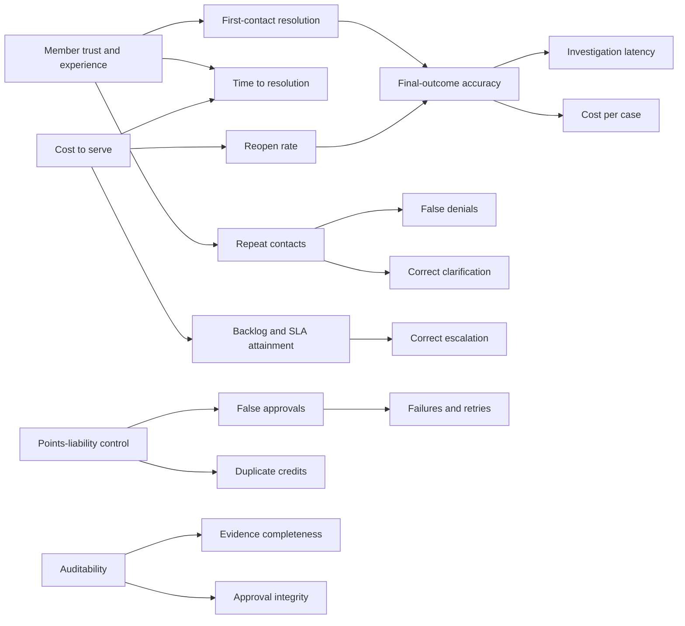

# KPI tree (Appendix F4)

> Simulated client engagement, synthetic data. Requirement LGF-04. Connects business goals to the numbers this
> project can measure. Every value in later reports says whether it is **observed** (measured in a run),
> **estimated** (computed from observed values and stated assumptions), **assumed**, or **unmeasured**.

## Layer 1: business goals
| Goal | Why it matters to the sponsor |
|---|---|
| Member trust and experience | Members who are under-credited write again or leave |
| Cost to serve | Agent time per correctly resolved request |
| Points-liability control | Over-credits and duplicates are real liability |
| Auditability | Finance and audit must explain every adjustment |

## Layer 2: operational KPIs
| KPI | Definition | Where it is measured | Status in this project |
|---|---|---|---|
| First-contact resolution | Share of cases resolved with no information request or reopen | Simulated member journey (F6) | Simulated |
| Time to resolution | Simulated days from request to final ledger state | Member journey | Simulated |
| Repeat contacts | Contacts per case beyond the first | Member journey | Simulated |
| Reopen rate | Cases reopened because the outcome was wrong | Member journey; synthetic history | Simulated |
| SLA attainment | Share resolved within the SLA target (proposed: 5 business days) | Synthetic history (F2) | Simulated |
| Backlog | Open cases over time | Synthetic history | Simulated |

## Layer 3: quality KPIs
| KPI | Definition | Where it is measured | Status |
|---|---|---|---|
| Final-outcome accuracy | Case success: final ledger and outcome correct, no duplicate (`docs/hypotheses.md` §1) | Benchmark, held-out | Observed (synthetic cases) |
| False denials | Under-credits | Benchmark | Observed |
| False approvals | Over-credits | Benchmark | Observed |
| Duplicate credits | Write path executed twice for one claim | Benchmark (all arms) and the A as-is variant | Observed |
| Evidence completeness | Required evidence (label) was retrieved before deciding | Benchmark traces | Observed |
| Correct escalation | Escalated exactly when the label says so | Benchmark | Observed |
| Correct clarification | Asked for the right item exactly when the label says so | Benchmark | Observed |
| Approval integrity | No execution without a valid bound approval; no self-approval | Tests, benchmark | Observed |

## Layer 4: system metrics
| Metric | Definition | Status |
|---|---|---|
| Investigation latency | Model + tools time per case, p50/p95, benchmark environment | Observed (live runs only for arm C) |
| API latency | Console and API response time | Observed (load test, M12) |
| Failures and retries | Tool errors, provider errors, retries per case | Observed |
| Cost per case | Model + API tokens × the provider's price, passed as inputs | Observed usage × stated price |

## Financial layer (estimates under stated assumptions)
`evaluations/financial_model.py` (Milestone 3) turns layer 2–4 values into money with the assumptions in
`docs/customer-discovery.md` §6 (A1–A4): over-credit leakage (points × $0.008), under-credit member-harm proxy,
handling cost (minutes × $32/hour; only from real timing, otherwise assumed), incremental AI cost, cost per correctly
resolved case, break-even volume, and a sensitivity table. Every output is labelled "estimate under stated
assumptions". Scripted step counts are never converted into employee time.
