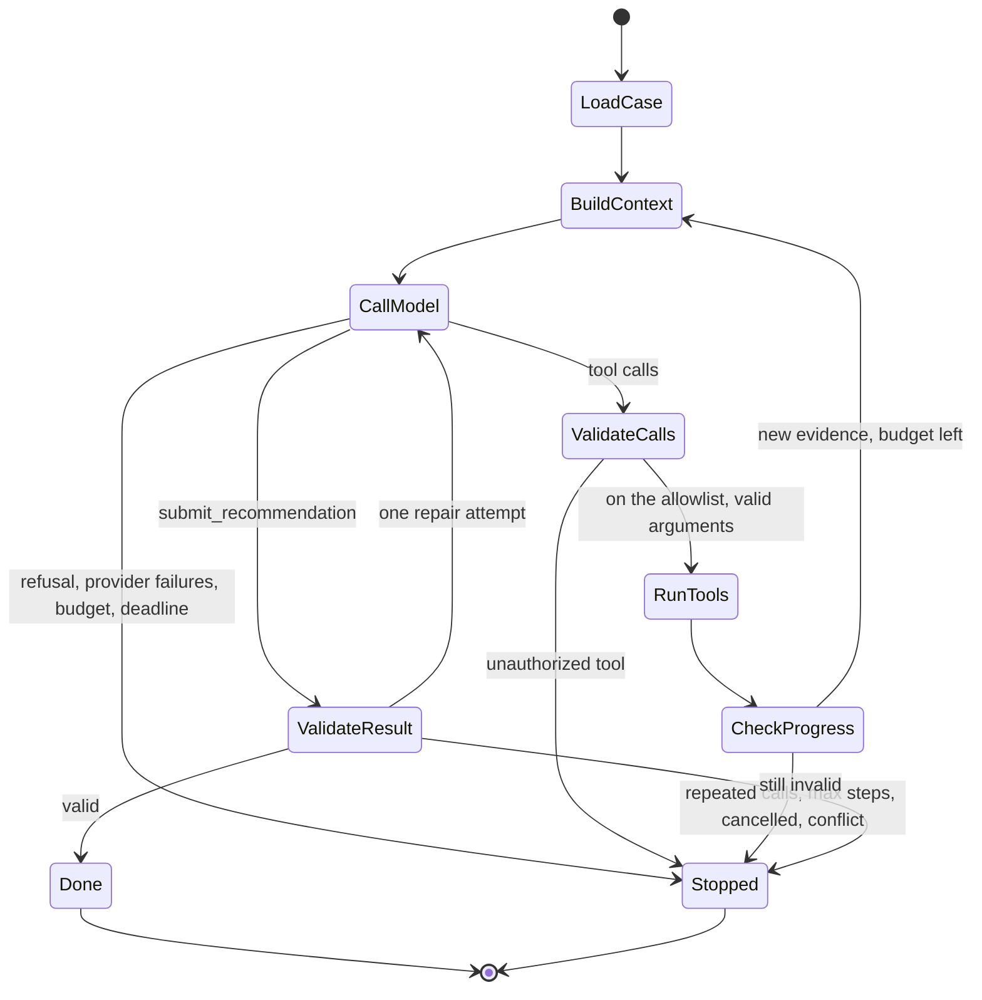

# RFC-0002: The AI loop and harness (arm C)
Status: accepted under the owner's standing instructions (2026-11-05)      Milestone: 8      Author: Claude Code (Opus 5.5)      Date: 2026-11-06

Everything here is a simulation with synthetic data. No number in this RFC is a result. Mock runs and live runs are never mixed.

## Context

Arm B works without a model. Arm C is arm B plus what only a model can add: reading unstructured requests (D16, D18's remainder, D19, D20, D23),
explaining a policy with citations, spotting what's missing, and drafting a reply for a person to review. The catalog predicts that AI's possible gain
is confined to 6 of 25 defects. This RFC is about adding that layer so that a model can't touch anything that matters.

Requirements: ARMC-01, ARMS-01, AI-01 to AI-17, ELIG-02, POL-06, POL-07, SEC-05, TEST-03, TEST-04, BENCH-10, OPS-05, ENT-01, ENT-02, ENT-05, ENT-06, ENT-12, ENT-15,
LIVE-05, DOC-02 to DOC-06, ML-01 to ML-05; spec B.9, Appendices C, H, I. Done when (Appendix C): every loop stop condition and injection test passes on the mock
provider; the Claude provider is implemented, and its live smoke test is run or marked NOT RUN.

## The one rule

**The model can read through narrow tools and write text. It can't decide.** Identity, eligibility, the amount, permissions, approval and execution stay in
deterministic Python, exactly where arm B has them. Whatever the model says, a credit still needs the engine's `adjust`, a different supervisor, the re-check and the
write path.

| The model may | The model may not |
|---|---|
| Choose which of the member's actual stays a vague message means, from a list the tools returned | Name a stay the tools didn't return |
| Say what a message is asking, and separate out what's out of scope | Change a queue, a status or a role |
| Explain the engine's result, citing sections it retrieved | Cite a section it didn't retrieve, or disagree with the engine |
| Draft a reply, labelled as AI-written, for a person to send | Send anything |
| Propose a question for the member | State an amount the engine didn't compute |

## Options considered

**Where the loop lives.** (1) Replace arm B's investigation with the model calling tools for everything. (2) Run arm B's investigation first, then let the model work only on what's
left, through tools. (3) Only summarize after arm B finishes. Option 1 makes C worse than B whenever the model skips a step, and makes D14-style reads depend on a model. Option 3 can't
fix D16, D19 or D23, which need interpretation before the reads. **Chosen: option 2.** The deterministic pipeline runs first and always; the loop gets its result plus tools for what's
unresolved. Trade-off: C always pays for B's reads. It also makes the fallback trivial: if the model fails at any point, the case holds arm B's result, and the page says so.

**Agent framework.** The Tool Runner, a graph library, or a manual loop. **Chosen: a manual loop** in `app/ai/loop.py`, as the explicit state machine B.9 asks for, with each step persisted. The Tool
Runner hides the checkpoints and stop conditions this RFC needs. No extra agents: one loop.

**Model.** **Claude Haiku 5.5** (`claude-haiku-5-5`), effort `low` to start, per Stage 2's and Stage 3's results and the portfolio default. The ID is pinned in configuration; an unknown ID fails safe to manual
(ENT-15). Haiku 5.5 runs adaptive thinking by default, rejects non-default sampling values and has no server-side refusal fallback, so a `refusal` stop reason is a stop condition here. Output is constrained by a
strict `submit_recommendation` tool. Hidden reasoning is never requested or stored (AI-15): the default `display` omits it, thinking blocks are passed back unchanged only as the API requires, and they are never written to our tables.

**Structured output.** Strict tools with `additionalProperties: false`, and every result validated again with Pydantic, because the mock and any future provider must pass the same gate.

## The loop (`app/ai/loop.py`)

An explicit state machine. Each transition is stored in `ai_steps`.

**Stop conditions, each with a test:** `sufficient_evidence`, `missing_information`, `unauthorized_action`, `repeated_tool_calls`, `unresolvable_conflict`, `max_steps`, `budget_exhausted`, `deadline`, `cancelled`, `provider_failures`. Also `invalid_result` after one repair, and `refusal`.

| Limit | Default | Why |
|---|---|---|
| Model turns | 6 | The same limit as Stage 2's agent; a person is waiting |
| Tool calls per turn | 4 | Bounded parallel reads |
| Repeated identical call | 2 | The second is already no new evidence |
| Deadline | 60 s | A person is waiting on a page |
| Budget per run | `LLM_BUDGET_USD_PER_RUN` | Set by the owner; checked before each call |
| Provider failures | 2 | Then the fallback, rather than retrying until the budget is gone |
| Repair attempts | 1 | B.9 |

These are starting points. Milestone 12 measures them.

**Exactly-once:** a checkpoint can't give exactly-once effects. The loop has no business effects: it only reads and stores text. Credits stay on the write path, where the platform's idempotency does that job (RFC-0001).

## Tools (`app/ai/tools.py`)

Read-only, narrow, schema-checked, authorized as the requesting person, with a timeout, structured errors, bounded output and the correlation ID: `get_member`, `get_stay`, `get_points_ledger`, `search_policy`, `evaluate_eligibility`.

- `get_member` only returns the case's confirmed member, or a candidate's masked match summary. It can't be pointed at an arbitrary number.
- `get_stay` only returns stays on the confirmed member's profiles, as summaries with IDs. Asking for another stay returns `not_found`, the same as a stay that doesn't exist (S03).
- `evaluate_eligibility` runs the engine for a stay ID on those profiles. It takes no amount and no facts from the model.
- `submit_recommendation` is how the loop ends. It goes through a validated application service (AI-06), not straight to the database.
- There's no SQL, shell, file, browser, network, payment or adjustment tool, and a test walks the registry to prove it (AI-07).

## Context (`app/ai/context.py`)

Trusted instructions are in the system prompt. Everything from a member or a document sits in the user turn inside labelled data blocks, and the prompt says it's data. Evidence carries its source and read time. A character budget caps it; a long history keeps the newest messages and says what it dropped. Only needed fields go: no email, phone or birth date, and free text passes through `app/ai/redaction.py` first (ENT-12, with limits stated).

Compaction isn't built: runs are short, so it isn't needed. Prior state is rebuilt from the database, and conversation memory proves nothing (AI-13).

## Validation (`app/ai/validation.py`)

The result must: name an action equal to the engine's for that stay; state no amount (the schema has no such field, and the engine's number is what's shown); cite only sections retrieved in this run; disclose what's missing; and carry no percentage (AI-17). One repair, then the deterministic fallback: arm B's result stands, flagged `ai_fallback` with the reason. A model that disagrees with the engine is logged as a disagreement. The engine wins (ELIG-02).

**What a recommendation holds (AI-16):** case summary, observed facts, the engine's result, citations, missing information, recommended action, escalation reason. Model text is stored apart from engine fields, so the UI can label it (ENT-05) and show the evidence and the engine's result first (ENT-06).

## Providers

`app/ports/model_provider.py` is the port. `app/adapters/mock_model.py` is deterministic, needs no key and labels every result `mock`. `app/adapters/anthropic_model.py` uses the official SDK with its own timeout and limited retries (transient only). Prices are configuration with a date, never in code (`config/ai/hg-demo.yaml`). Both pass the same contract tests.

**Spending caps (LIVE-05):** `ai_spend` holds daily and monthly totals in the database, so a restart doesn't reset them. A run that would pass a cap doesn't start. Unknown prices stop a live run.

## Storage

Migration 0009: `ai_runs` (run ID, case, caller, provider, model, prompt version, policy versions, status, stop reason, usage, cost, timing), `ai_steps` (tool name, argument hash, status, size, timing: **not the raw content of evidence**), `ai_spend`, `case_attachments`. Traces hold no secrets, and a test scans them.

## Fairness (F9)

- Arm C's model sees what arm B can read, through the same port, and nothing else. No labels, and a test keeps `app/` from reaching them.
- **Anything deterministic goes to arm B too.** Writing this RFC showed that D18's married names don't need a model: an exact email and an exact confirmation number on that profile are two identifiers, which is the catalog's own detection method ("name differs, other identifiers match"). So this goes in the shared identity code, for arm B as well. The catalog predicted C would fix these, so if it holds, that's a prediction missed in arm B's favour, reported as such. It doesn't weaken the two-identifier rule: both are checked by code, and a near match never counts.
- D22: the non-AI baseline reads clean folios' text layer and `.eml` files with rules, before the benchmark (closes TD-31). Noisy images are for vision through the provider. Tesseract isn't installed here, so OCR on images is **Blocked with prerequisites**, not faked.
- Arm A stays fenced.

## Extraction and routing baseline (Tier 2)

Only after the Tier 1 checks pass (spec 0.7). Extraction per Appendix H: a typed schema, two methods, confidence from verifiable signals only, review routing, evidence only. Routing per Appendix I: rules vs TF-IDF + logistic regression on the same grouped splits, trained and selected on dev and validation; held-out reporting is Milestone 10. A $0 model that's good enough gets used.

## Rollout, rollback, risks

- `AI_PROVIDER=mock` is the default. Live needs `FEATURE_LIVE_AI=true`, a key and a cap. Turning it off drops arm C to arm B's result, with no migration.
- **Live smoke test:** costs money, so it needs the owner's go-ahead. Until then it's recorded as **NOT RUN**.
- **Risks:** automation bias on the supervisor's page (evidence first; Milestone 10 has a variant); a model that reads an injected instruction and writes it into a draft (drafts are never sent, and are labelled; injection tests assert on business effects); mock results mistaken for model quality (every mock result is labelled, and no benchmark number may come from it).

## What would change this decision

Evidence at Milestone 10 that the loop adds nothing over arm B on these defects (then ship B and drop it), a provider without strict tools, or a customer who forbids sending any member text to a model.
