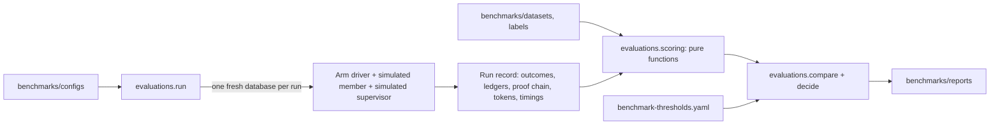

# RFC-0003: The benchmark (arms A, B and C)
Status: accepted under the owner's standing instructions      Milestone: 10      Author: Claude Code (Opus 5.5)      Date: 2026-11-06

Everything here is a simulation with synthetic data. **No number in this RFC is a result.** Cost figures are labelled estimates until a live run measures them.

## Context

Arms A, B and C now exist. Milestone 10 finds out what each is worth, on terms written before any of them was built: `docs/hypotheses.md` and `docs/legacy-defect-catalog.md` (pre-registered 2026-10-28, commit `1f8b8e6`), and `docs/experiment-plan.md`. This RFC doesn't get to change those. It decides how to measure them honestly.

Requirements: BENCH-01 to BENCH-13, LEG-01, LEG-03, UI-02, BIZ-01, BIZ-02, BIZ-04, LGF-07 to LGF-10, LGF-14, LGF-16, ENT-04, ENT-07, ENT-08, ENT-17, ENT-38 to ENT-41, DOC-05, ML-02, ML-04, REUSE-03, PURP-05, SEC-19. Done when (Appendix C): thresholds file committed before runs; A/B/C reports generated from actual runs; error analysis written.

## The one rule

**The runner measures, and the pre-registered rules decide.** A verdict comes from code applying `docs/hypotheses.md` §2 to stored runs. Nobody chooses it after seeing the numbers, including me.

## What could make this dishonest, and what stops it

| Risk | Guard |
|---|---|
| Thresholds drift towards the results | The file is committed first, and a test checks each value against `docs/hypotheses.md` |
| Tuning on held-out data | Held-out runs need `--confirm-frozen`, a clean tree and a recorded commit. A failing held-out case can't be fixed and re-scored: that's a new experiment on a new held-out set (F9) |
| A mock result read as Claude's quality | Separate folders, a label in every report, and code that refuses mock runs for H2–H5. Without live runs, they say **not tested (NOT RUN)** |
| Spending past the cap | The runner stops itself (below). It doesn't rely on settings alone |
| Dangerous errors hidden in a total | False approvals and denials are always separate, with counts, denominators and per-scenario tables |
| Arm C gets credit for arm B's gains | C's comparison is against B on paired cases. Write-path gains go to the platform (A vs A as-is) |
| Only flattering slices reported | The report lists every slice where A or B beats C, generated, not chosen |
| Labels leak into the app | Labels load only in `evaluations/` and `benchmarks/`. `tests/test_generator.py` already forbids the reverse |
| Unreviewed labels presented as truth | Reports state how many labels had a human review. The 30-label review is still open with the owner: until then they say "generated from scenario facts; not independently reviewed" |

## Options considered

**Where runs happen.**
1. Against the Compose stack: closest to real, but about an hour per pass on this machine, and state carries over between runs.
2. In one process on a disposable SQLite file, with the worker driven directly: fast, isolated, repeatable.
3. Each run on a disposable Postgres database: real, and much slower.

**Chosen: 2 for every run, plus one confirming pass of the deterministic arms on real Postgres, whose outcomes must match case for case.** Milestone 9 showed the two databases can behave differently, so the confirmation isn't optional. Latency is declared as "benchmark environment", and it isn't a claim about production.

**How arms are driven.** Through the same services the console calls, with ordinary accounts and permissions (ADR-0048), not a simplified model of them. Arm A and B's scripted agents exist. Arm C uses the same driver as B, with its AI step in between.

**Judging explanations.** An LLM judge needs calibration against human labels (BENCH-09), and Stage 3 showed how hard that is (kappa 0.29). **Chosen: no judge.** Citation correctness and unsupported claims are deterministic checks. Whether an explanation reads well stays **unmeasured**.

## The design

- **Scoring is pure functions** over stored records, unit-tested on hand-built cases, so a corrected metric can re-score old runs without spending anything. Raw records are kept.
- **Results by kind:** `benchmarks/results/deterministic/`, `.../mock/`, `.../live/`. Each run stores dataset version and checksum, prompt, model, policy and application versions, configuration, cache state, timings, tokens and cost.
- **Proof chain (F7):** each case records the first link that failed, which gives the failure funnel per arm.
- **Simulated member and supervisor** exactly as `docs/hypotheses.md` §1 defines them, labelled simulated. The automation-bias variant is reported separately and never replaces the main analysis.
- **A as-is** lives in `benchmarks/`, on a disposable database only, and can't be imported by the app (a test enforces it). It's descriptive and excluded from H6.
- **Statistics:** paired bootstrap, 10,000 resamples, seed 9, 95% percentile interval. Raw and re-weighted results both, using the weights in `benchmarks/datasets/v1/composition.md`.

## Decision: what happens after the re-check stops a credit

**Decided 2026-11-07, with the owner, before any held-out run.**

**Context.** On D11, a posting lands between approval and execution, and the shared write path's re-check stops the credit. The case is then back in `Investigating`, and each scripted agent's script ends there. The label's outcome is `no_adjustment`.

**Options.**

1. **Scripts as written, for every arm.** The ledger is right, the case stays open, and it fails case success because no one closed it.
2. **A second look, for every arm.** A person works the case again. I first built this, without authority from the catalog or an ADR.
3. **Arm A as written, arm B with a second look.** Arm B wins these cases through a step the runner added.

**Decision: option 1, as the owner asked.** Scripted agents follow their scripts, and don't act like careful people. `docs/hypotheses.md` section 1 says D10 and D11 are "credited to neither B nor C", and option 3 would break that. Arm C uses the same driver as arm B, so it gets the same rule.

**What this isn't.** It doesn't touch D06's prediction that arm A over-credits. No re-check stops a D06 credit, so the second look never fires there. `tests/test_runner.py::test_the_second_look_only_ever_acts_on_a_stopped_credit` holds that on D06, D15, K01 and K02.

**Trade-off.** Every arm fails D11 on case success, though its ledger is right. Case success therefore understates all arms by the same cases, and "Final ledger correct" and "Left unresolved" are separate rows so that's visible. Under option 1 the difference between arms doesn't change.

**The three variants stay in a sensitivity report for each split the arms run on,** so the choice can be challenged. `--second-look` selects the variant, and `evaluations/sensitivity.py` writes the report.

**Measured on dev, 100 cases, commit `39f96ec` (`benchmarks/reports/deterministic/dev-after-stop-sensitivity.md`). Dev only: no verdict.**

| Variant | A case success | B case success | B minus A |
|---|---|---|---|
| 1. Both as written **(main analysis)** | 61/100 | 89/100 | +28.0 pp (95% interval +18.0 to +38.0) |
| 2. Both with a second look | 63/100 | 91/100 | +28.0 pp (+18.0 to +38.0) |
| 3. A as written, B with a second look **(biased, comparison only)** | 61/100 | 91/100 | +30.0 pp (+20.0 to +40.0) |

The second look changes only DV-031 and DV-089, both D11, on both arms. Right ledgers are the same whichever way: A 67/100, B 93/100. Arm A's over-credits don't move: D06 1/3, D07 2/2, D15 2/2. So the choice moves both arms equally, and option 3 would have handed arm B 2 points.

**A finding from the same data:** the catalog predicts arm A over-credits on D06, and it did on DV-006 (6,360 points against 3,180). DV-041 and DV-099 came out right by accident: they're Mountain Lodge stays, where arm A's stale 30-day rule (D08) says "wait", so it never credits. Their first action is still wrong.

**What would change this:** a catalog or ADR change saying a person handles a stopped credit, logged in `docs/hypotheses.md` as a new experiment (F9).

## The $5 limit

The owner approved live runs with a **hard cap of $5 total** across the smoke test and the live evaluation (2026-11-06).

- **`benchmarks/results/live/spend-ledger.jsonl`** is append-only, committed, and never reset. Every live call adds its measured tokens and cost.
- **Before each case,** the runner adds what's been spent to that case's worst possible cost (its token limits at list price). If that passes the cap, it stops and marks the run **interrupted**. Interrupted runs are never extrapolated.
- **Held-out money is reserved.** Other live work stops early enough to leave the held-out reserve untouched.
- **`LLM_BUDGET_USD_TOTAL`** stays as a second, independent stop. Please also set a limit in the Anthropic Console: that one holds even if this code is wrong.

| Order | Work | Purpose | Limit |
|---|---|---|---|
| 1 | Smoke test | The adapter works | Under $0.01 (estimate) |
| 2 | Dev, then validation | First real look at arm C. Fix what's wrong, then freeze | $1.00 |
| 3 | **Held-out × 3, plus 10 cases × 3 more** | **Decides H2–H5** | **$2.50, reserved** |
| 4 | Stress and fairness sets | Adversarial, consistency, slices | $0.75 |
| 5 | Ablations | Only with what's left | $0.75 or less |

**Estimate only, not measured:** about $0.002–$0.01 per investigation, from the model's list price and the configured limits. The smoke test and first dev cases replace this with measured numbers. If the real cost makes this plan too expensive, ablations go first, then stress and fairness. Held-out comes last to be cut, and if it can't finish, H2–H5 are reported as not tested.

## Order of work

1. This RFC, `benchmark-thresholds.yaml` and config schema: **merged before any scoring runs** (BENCH-01, ADR-0048).
2. Scoring, proof chain, member and supervisor, tested on hand-built cases.
3. Runner and arms A, A as-is and B on dev and validation. Fix runner bugs. Arm changes here need a reason in the log.
4. Arm C on mock (pipeline only), then live on dev and validation. Then **freeze**.
5. Held-out: A, A as-is, B, each with a repeat, then C × 3, stress, fairness, fault-injection pass, Postgres confirmation.
6. Compare, verdicts, dashboard, RCA, error analysis, business-value report, predicted vs actual.

Steps 1–3 need no key. **Step 4 onward waits for the Anthropic settings in `.env`.**

## Risks and open questions

- **80 held-out cases give wide intervals.** H2 was predicted inconclusive before any data. That's an acceptable answer.
- **Simulated people.** The member and supervisor are deterministic policies, so nothing here measures real reviewers or real satisfaction. H7 stays **not tested** without participants.
- **If H6 fails anywhere,** analysis stops until the write path is fixed and every run is repeated, which could mean a second held-out spend. Arms A and B cost nothing to repeat. Repeating arm C could need a new approval if the cap is short.
- **The scenario set was written by the same author as the arms.** It's pre-registered, and that limits the problem without removing it. Reports say so.
- **Reuse:** REUSE-03 exports results in eval-harness format here. The PR to `eval-harness` needs the owner's OK, because it's a different repo.

## What would change this

A real customer's data replaces all of it. A held-out result showing C's value lives in one category would narrow arm C to that category, as `docs/hypotheses.md` §4 already says.
