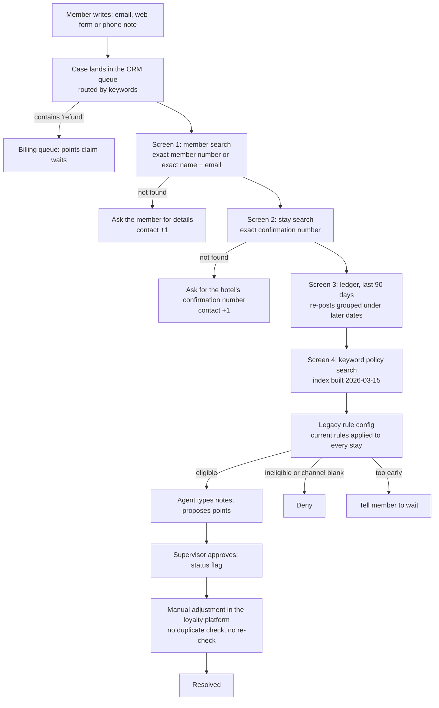
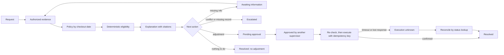
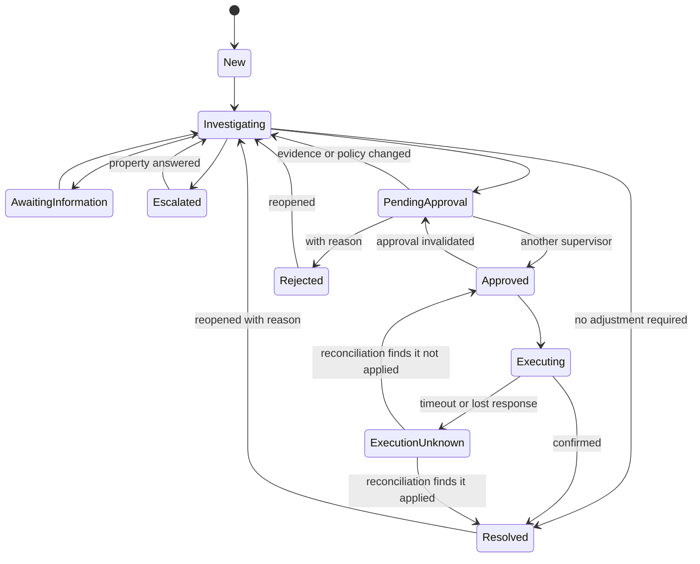

# Workflow: current and proposed

> Simulated client engagement, synthetic data. Requirement DISC-04. Handling times and costs are **assumptions**
> (`docs/customer-discovery.md` §6, A2–A3), not measurements.

## 1. Current workflow (legacy, arm A)

| Step | Who | System | Manual work | Time (assumed) |
|---|---|---|---|---|
| Triage | Queue rules | CRM | Keyword routing; multi-issue messages misrouted | — |
| Find member | Agent | Loyalty platform, screen 1 | Exact match only | 2 min |
| Find stay | Agent | PMS view, screen 2 | Exact confirmation only; partner numbers not indexed | 3 min |
| Check ledger | Agent | Loyalty platform, screen 3 | Read postings; reversals look like gaps; no pending feed | 2 min |
| Find policy | Agent | Keyword search, screen 4 | Stale index; today's rules only | 2 min |
| Decide | Agent | Legacy rule config | Blank channel = ineligible; one property's wait still 30 days | 2 min |
| Notes and proposal | Agent | CRM | Free-text notes of uneven quality | 2 min |
| Approve | Supervisor | CRM status | Approves on trust; nothing binds the approval | 1 min |
| Adjust | Agent | Loyalty platform | Manual; a retry after a timeout is a new adjustment | 1 min |

Median about 14 minutes per case (assumption A2), more for multi-stay requests. Loaded cost about $7.50 per case at
$32 per hour (assumption A3). These figures feed the financial model as assumptions only.

## 2. Proposed workflow (target, spec A.1)

1. **Request** arrives (form fields, free text, optional attachment); stored as data, never as instructions.
2. **Authorized evidence retrieval:** member, stays, ledger (posted, pending, reversed), case history, all filtered
   by the caller's role and customer before anything reaches a model.
3. **Applicable policy** chosen by checkout date in Eastern time.
4. **Deterministic eligibility** with points, reasons and policy references.
5. **Explanation with citations** (arm C drafts it; arm B shows the rule's reasons).
6. **Branch:** clarification (Awaiting information), escalation, proposed adjustment (Pending approval), or no
   adjustment required (credited, pending posting, wait until a date, not checked out, ineligible).
7. **Supervisor approval**, bound to the exact action; the proposer can't approve.
8. **Simulated adjustment** through the mock loyalty API with an idempotency key from the approval, after re-checking
   eligibility and the ledger.
9. **Reconciliation** of uncertain outcomes (timeout, lost response) by status lookup before any retry.
10. **Audit history and metrics.**

## 3. Case states (spec B.10; full diagram and tests in Milestone 6)

## 4. System boundaries and ownership

| System (synthetic stand-in) | Holds | Owner (client side) | This project's access |
|---|---|---|---|
| Loyalty platform (mock customer API) | Members, points ledger, posting queue, adjustment API | Loyalty data owner / IT | Read; adjustments only via the API with an idempotency key |
| PMS (mock customer API) | Stays, channels, partner confirmations, folios | Property IT | Read |
| CRM / case system | Cases, notes, attachments | Support operations | This app is the case system in the simulation |
| Policy repository | Versioned policy documents | Administrator | Read; publish through the workflow |
| Model provider (arm C only) | Nothing stored by design; prompts in transit | Vendor management | Minimised, redacted context only |

## 5. Member journey (simulated, F6)
Request → (each information request is a contact; the simulated member answers only if the question asks for
something the scenario holds) → resolution → reopen if the outcome was wrong. Measured per arm in Milestone 10:
contacts per case, simulated days to resolution, whether the member ended with the correct points, and the modelled
satisfaction proxy. All labelled simulated.
