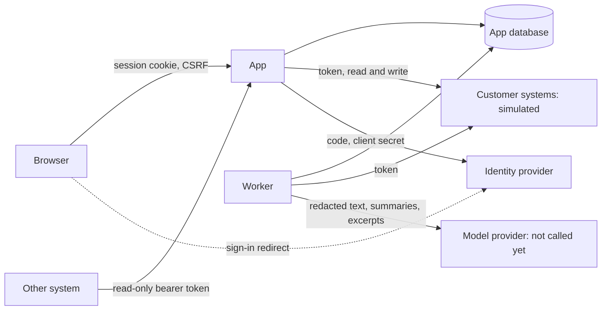

# Data flow (SEC-02)

> Simulated engagement, synthetic data. **Technically verified for the tested scope; organizational approvals pending.** No certification or compliance is claimed.

See `docs/data-flow-map.md` for what each flow carries.

**Trust boundaries:** browser to app; machine to app; app to customer systems; worker to model provider; app to identity provider. Everything crossing into the app from a member, a document, a tool result or a model is data.
