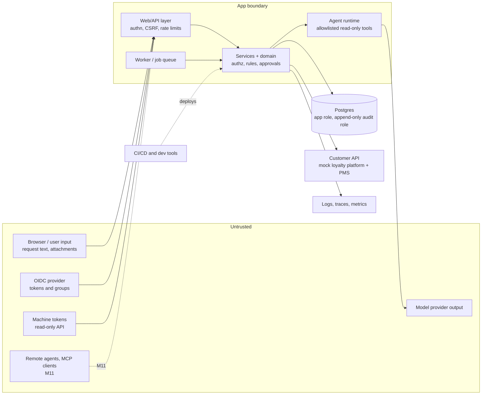

# Threat model (canonical; v1.0, Milestone 9)

> Simulated client engagement, synthetic data. Requirements SEC-03 (draft) and SEC-02 (this file). It is updated
> whenever an integration changes. Standards and their versions: `standards-baseline.md`. Controls:
> `control-matrix.md`. Results: `test-results.md`. No certification or compliance is claimed. `docs/threat-model.md`
> links here.

## 1. Assets
| Asset | Why it matters |
|---|---|
| Points ledger and the adjustment API | Points are money-like; a wrong or duplicate credit is liability |
| Approvals | The control that stops unilateral adjustments |
| Member data (names, emails, phones, stays) | Personal data (synthetic here, real in a pilot) |
| Policies and rule configuration | Changing them changes every decision |
| Audit trail | Evidence for finance and audit |
| Secrets (DB, mock API token, model key, OIDC client secret) | Access to everything above |
| Model budget | Spend can be abused ("denial of wallet") |

## 2. Trust boundaries

Boundaries (spec C.2): browser and frontend · backend · agent runtime · worker and queue · database and storage ·
model provider · MCP servers · remote agents · customer APIs · CI/CD · monitoring · external development tools ·
identity provider (its tokens are checked, its groups map to roles, and an account deactivated here stays out) ·
machine tokens (read-only, short-lived, stored as hashes).

## 3. Actors
Malicious user; compromised agent or supervisor account; insider (an agent approving their own work, a supervisor
colluding); malicious document or request text; malicious tool or API response; compromised dependency;
overprivileged service; misconfiguration; accidental disclosure; replay; resource exhaustion.

## 4. Threats, prioritised (impact × likelihood × exposure; 1–3 each)

| ID | Threat | Boundary | I | L | E | Score | Planned control | Test | M |
|---|---|---|---|---|---|---|---|---|---|
| T01 | Prompt injection in request text or a folio makes the agent propose a large credit or skip a step | Agent runtime | 3 | 3 | 3 | 27 | Rules decide eligibility and points; agent has read-only tools; supervisor approval required; output validated against the deterministic result | Red-team cases asserting no points moved (S01, S02) | 8–9 |
| T02 | Duplicate credit after timeout or two cases for one stay | Customer API | 3 | 3 | 2 | 18 | Idempotency key from the approval; ledger re-check before execution; reconcile before retry | Real-Postgres concurrency and timeout-after-commit tests | 6 |
| T03 | Self-approval or approval forged via a form field | Backend | 3 | 2 | 3 | 18 | Server-side role and identity only; proposer ≠ approver; approval hash | `tests/test_red_team.py`, `tests/test_write_path_postgres.py` | 6, 9 |
| T04 | Approval reused after evidence or policy changed | Backend | 3 | 2 | 2 | 12 | Hash over member, stay, points, policy version, evidence snapshot, approver, expiry; recomputed at execution | Approval-invalidation tests | 6 |
| T05 | Broken object-level authorization: reading another customer's or member's records | Backend | 3 | 2 | 3 | 18 | Deny by default; customer and record scope on every query; separate deployments per customer | `tests/test_security_authz.py`, `tests/test_security_postgres.py` (found a real bug: the approvals list wasn't scoped) | 9 |
| T06 | Agent reads data the requesting user can't (over-broad service scope) | Agent runtime | 3 | 2 | 2 | 12 | On-behalf-of: tools run with the user's permissions | `tests/test_ai_tools.py`, `tests/test_arm_c.py` (ENT-23) | 8–9 |
| T07 | Secret leak through logs, traces, prompts, errors, screenshots or Git | All | 3 | 2 | 2 | 12 | Env/secret manager only; redaction; preflight never prints values; leak test; gitleaks in CI | `tests/test_secrets_hygiene.py` (built), gitleaks (M12) | 1, 12 |
| T08 | Personal data sent to the model unnecessarily | Model provider | 2 | 3 | 2 | 12 | Minimised context; PII redaction before model calls; configured destination only | Redaction and context tests | 8 |
| T09 | Malicious or wrong policy published | Backend | 3 | 1 | 2 | 6 | Draft → regression checks → publish by administrator; pending approvals cancelled; audit | Publishing tests | 6 |
| T10 | Denial of wallet / resource exhaustion through crafted requests | Agent runtime | 2 | 2 | 3 | 12 | Step, token, cost and wall-clock limits; per-user rate limits; daily and monthly caps stored in the DB | Budget-stop tests (S04) | 8, 12 |
| T11 | XSS or unsafe links from request text or model output | Browser | 2 | 2 | 3 | 12 | Autoescaping templates, sanitised output, CSP, no model-generated HTML | `tests/test_red_team.py`, `tests/test_console_web.py` | 7, 9 |
| T12 | SSRF through URLs in requests, callbacks or protocol discovery | Backend | 2 | 1 | 2 | 4 | No model-selected URLs; outbound allowlist; block internal ranges and metadata | `tests/test_security_authz.py` for `app/outbound.py`; callbacks at M11 | 9, 11 |
| T13 | Audit trail tampering | Database | 3 | 1 | 1 | 3 | Append-only role; integrity stated honestly (not tamper-proof unless tested) | Role permission tests | 6 |
| T14 | Compromised dependency | CI/CD | 3 | 1 | 2 | 6 | Pinned lockfile, pip-audit, SBOM, Dependabot, container scanning | CI (M12) | 12 |
| T15 | Replay of a session or an approval request | Backend | 2 | 1 | 2 | 4 | Server sessions with expiry, CSRF tokens, approval expiry, idempotency | `tests/test_red_team.py`, `tests/test_console_web.py` | 9 |
| T17 | A forged or replayed OIDC token, or a group claim granting too much | Identity provider | 3 | 1 | 2 | 6 | PyJWT checks signature, issuer, audience, expiry and nonce; `alg: none` refused; no mapped group means no access; local deactivation wins | `tests/test_oidc.py`, `security/evidence/oidc-check-2026-11-06.txt` | 9 |
| T18 | A stolen machine token | Backend | 2 | 1 | 2 | 4 | Read-only, short-lived, hashed at rest, revocable, per-identity rate limit, named in the log | `tests/test_security_authz.py` | 9 |
| T19 | Password guessing and flooding | Backend | 2 | 2 | 3 | 12 | Limits per account and per address, in the database; per-identity request limit | `tests/test_security_authz.py`, `tests/test_security_postgres.py` | 9 |
| T16 | The unsafe "A as-is" path reachable outside the benchmark | Backend | 3 | 1 | 1 | 3 | Lives only in the benchmark runner on a disposable DB; not importable by the app; test enforces | Isolation test | 10 |

## 5. Assumptions and out of scope (for now)
Local Docker only; no public deployment until the owner approves one (Appendix L1). Physical security, the model
provider's internal security and the client's IdP hardening are outside this project's control and are listed as
residual risks: `residual-risks.md`.
